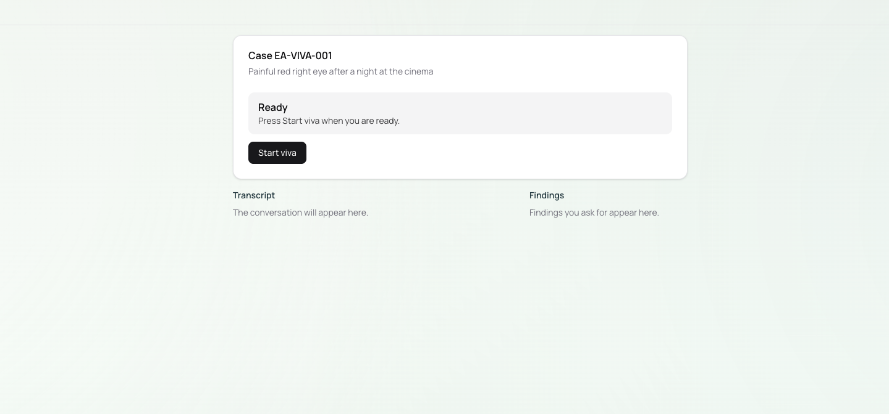
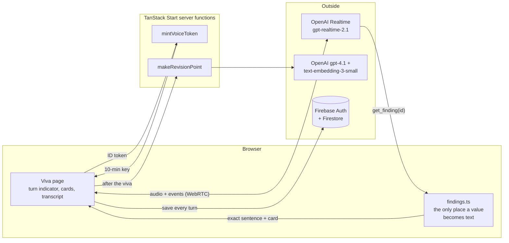
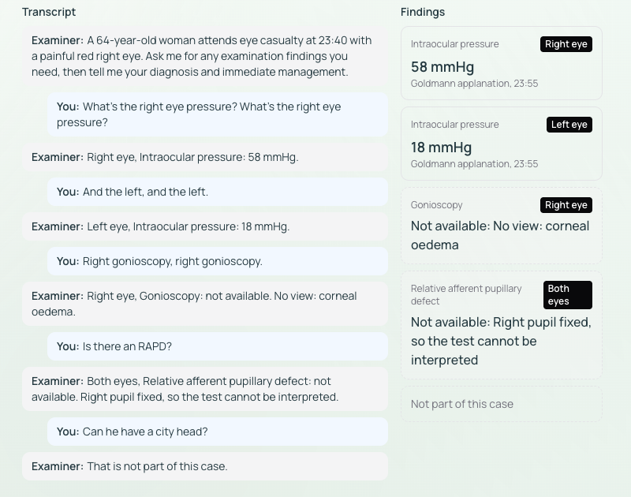
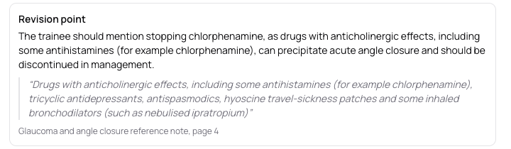

# Eye Academy voice viva

A short spoken ophthalmology viva:

1. A signed-in trainee asks the examiner for findings on case EA-VIVA-001.
2. They give a diagnosis and management.
3. They answer one follow-up question.
4. They get one revision point, cited to a page of the glaucoma reference note.

Built with TanStack Start, Firebase Auth, Firestore and the OpenAI Realtime API.

**Live demo:** https://eye-academy-viva.eye-academy-viva.workers.dev (test login in the submission email). Use Chrome and allow the microphone.



## Status after four hours

- **Build time:** 2 h 52 min, from 15:25 to 18:17 PKT on 25 Nov 2026. Git tags [`four-hour-start`](../../tree/four-hour-start) and [`four-hour-mark`](../../tree/four-hour-mark) mark the start and end.
- **What works:** every part of the brief, run locally:
  - voice viva
  - findings with the correct eye, value and unit
  - unavailable findings
  - one follow-up
  - turn indicator
  - private saved attempts
  - cited revision point
- **Where it stopped:** after the three checks. It was not deployed. The last two fixes passed their unit tests but were not re-tested by voice.
- **After the clock:** deployed to Cloudflare Workers, response times removed from the screen (still saved), a favicon, and these docs.

Details: [`docs/status-four-hour-mark.md`](docs/status-four-hour-mark.md).

## Run it locally

**You need:** Node 24+, pnpm, Java 11+ (only for the rules tests), a Firebase project, and an OpenAI API key.

1. **Firebase console:**
   - Enable Email/Password sign-in.
   - Add two test users.
   - Create a Firestore database.
   - Copy the web app config.
2. **Config files** (both are ignored by git):
   ```bash
   cp .env.example .env.local                  # fill in the Firebase web config
   echo "OPENAI_API_KEY=sk-..." > .dev.vars    # server only, never sent to the browser
   ```
3. **Install, deploy the privacy rules, and start:**
   ```bash
   pnpm install
   pnpm exec firebase login
   pnpm exec firebase deploy --only firestore:rules --project <your-project-id>
   pnpm dev
   ```
4. Open http://localhost:3100 in Chrome, sign in, press **Start viva**, and allow the microphone.

| Command | Checks |
|---|---|
| `pnpm check` | Typecheck, 28 unit tests, and 4 Firestore rules tests |
| `pnpm check:findings` | Checks 1 and 2 (no API key needed) |
| `pnpm check:citation` | Check 3, using the real models |
| `pnpm prep:note` | Rebuilds the reference note index after the PDF changes |
| `pnpm run deploy` | Builds and deploys to Cloudflare Workers (first `wrangler login`, `wrangler secret put OPENAI_API_KEY`, and add the workers.dev domain to Firebase authorized domains) |

## How it works



- **Findings.** The voice model never knows the values. It calls the tool `get_finding`, and the reply and the card both come from the case file. This is why 58 (right) and 18 (left) cannot get swapped. A test checks that no value appears in the examiner's instructions.
- **Unavailable findings** are decided by the case's `available` flag. For example, RAPD has a value but is marked unavailable, so the examiner says it is not available and gives the reason.
- **Turn-taking.** A status label shows whose turn it is: Examiner speaking, Your turn, Listening, Thinking. A text box works without a microphone.
- **Follow-up.** The app allows exactly one, and the viva cannot end before it.
- **Saved attempts.** The transcript, findings, follow-up and revision point are saved after every turn at `users/{uid}/attempts/{id}`. Only the owner can read them; another user gets "Permission denied".
- **The OpenAI key** stays on the server. The browser gets a 10-minute key, and only after its sign-in is verified.

More detail: [`docs/architecture.md`](docs/architecture.md) (diagrams, data, security), [`docs/decisions.md`](docs/decisions.md) (each choice and why), [`docs/tickets.md`](docs/tickets.md) (how the work was split).

## Model choice

**Voice: OpenAI Realtime (`gpt-realtime-2.1`).**

- It reliably calls the finding tool, which every answer depends on.
- WebRTC handles the microphone, echo and playback.
- It sends clear events that drive the turn label and the timer.
- It is already in Eye Academy's stack.

**Alternative considered: Gemini Live.** Its published audio prices are lower (not measured here). It needs our own audio streaming code, and its short-lived browser keys were still in preview.

**Revision point:** `gpt-4.1` at temperature 0, with `text-embedding-3-small` embeddings. I tried `gpt-4.1-mini` first, but it called a correct step a mistake.

## Response time

The timer starts when the server detects that the trainee stopped speaking (`input_audio_buffer.speech_stopped`). It stops when the examiner's voice starts playing in the browser (`output_audio_buffer.started`). It is measured with `performance.now()`.

| Turn | Turns | Median | p90 | Worst |
|---|---|---|---|---|
| Finding lookup | 5 | 1582 ms | 1769 ms | 1838 ms |
| Plain reply | 2 | 990 ms | – | 1523 ms |

5 and 2 turns, so the numbers are indicative. The wait for the end of speech happens before the timer starts and is not included. Times are saved with each attempt and logged for developers; trainees do not see them.

## Three checks

| Check | Expected | Observed |
|---|---|---|
| Available finding: "right eye pressure", "and the left" | Right eye 58 mmHg, left eye 18 mmHg | ✅ Examiner: "Right eye, Intraocular pressure: 58 mmHg." / "Left eye, …: 18 mmHg." Cards matched |
| Unavailable finding: right gonioscopy, RAPD, CT head | Not available with the reason; "not part of this case" for CT head | ✅ "Right eye, Gonioscopy: not available. No view: corneal oedema." RAPD not available with its reason. CT head (heard as "city head"): "That is not part of this case." |
| Citation: an answer that misses the sulfonamide allergy check | Page 6, with a quote about sulfonamide | ✅ Retrieved pages 6, 9, 8, 3. Cited page 6: "Check for sulfonamide allergy, kidney disease, low potassium and sickle cell disease before giving it." |





All runs, the commands to repeat them, and the "No support found" case: [`docs/checks.md`](docs/checks.md).

## Handover: the reference note

**Preparation** (`pnpm prep:note`):

1. Read the text of each PDF page.
2. Stop if a printed page number doesn't match the page. A wrong number would make every citation wrong.
3. Remove headers and footers.
4. Split each page into small chunks. A chunk never crosses a page, so each one has exactly one page to cite.
5. Embed the chunks into `data/note-index.json`: 10 pages, 45 chunks.

**Picking passages** (after the viva):

1. Find the biggest gap between the trainee's answer and the examiner's key points.
2. Search the chunks by keywords and by meaning, and keep the top 4.
3. Write one point that quotes one passage.
4. **Code checks the quote** is on the cited page, word for word. If it isn't, the trainee sees "No support found in the note".

The note contains distractors. "Sulfonamide" appears on pages 4, 6, 8 and 9, but only page 6 is the allergy check before acetazolamide. See [`docs/note-page-map.md`](docs/note-page-map.md).

## AI coding tools

I built this with Claude Code.

**Example:** it wrote the findings formatter ([`src/case/findings.ts`](src/case/findings.ts)) test-first. The tests cover the case's traps:

- 58 vs 18
- "5 mm", not "5 mm mm"
- RAPD hidden
- unknown findings

**How I verified it:** 9 of the 28 unit tests (formatter and case file), `pnpm check:findings`, and a voice run where every answer and card matched.

## Improvements

1. **Built: the follow-up is enforced in code.** The brief requires one spoken follow-up, and in one test run the model ended without asking it. A prompt can't guarantee that, so now the app allows exactly one, and refuses to end the viva before it. Both rules are tested.
2. **Next: an end-to-end test on the Firebase emulators.** Today the signed-in voice path is checked by hand. A Playwright test using fake users and the text box would make the checks one command: sign in, ask "right eye pressure", see 58 mmHg on the right eye, finish, reopen, and see a second user denied. That makes it safe to change the prompt or the model.

## Making a change

| To change | Edit | Then run |
|---|---|---|
| A finding (value, unit, or available / not available) | `data/case-ea-viva-001.json` | `pnpm check:findings` shows what the examiner will now say |
| How many follow-up questions | `MAX_FOLLOW_UPS` in `src/voice/session-config.ts` | `pnpm test` |
| The reference PDF | `data/glaucoma-note.pdf` | `pnpm prep:note`, then `pnpm check:citation` |


## Limitations

- A long pause can end the trainee's turn early, and a short reply can take a few seconds to be picked up.
- Medical words are sometimes misheard.
- There is one case and no case picker.

## Project layout

```
src/case/        case schema and the findings formatter
src/voice/       voice session, examiner setup, follow-up rules, latency
src/note/        chunking, search, quote check
src/server/      server functions: voice key, revision point, sign-in check
src/attempts/    saving and loading attempts
src/routes/      login, viva, attempts list, attempt page
scripts/         prep-note, check-findings, check-citation
tests/rules/     Firestore rules tests (emulator)
docs/            architecture, decisions, tickets, checks, note page map
```
