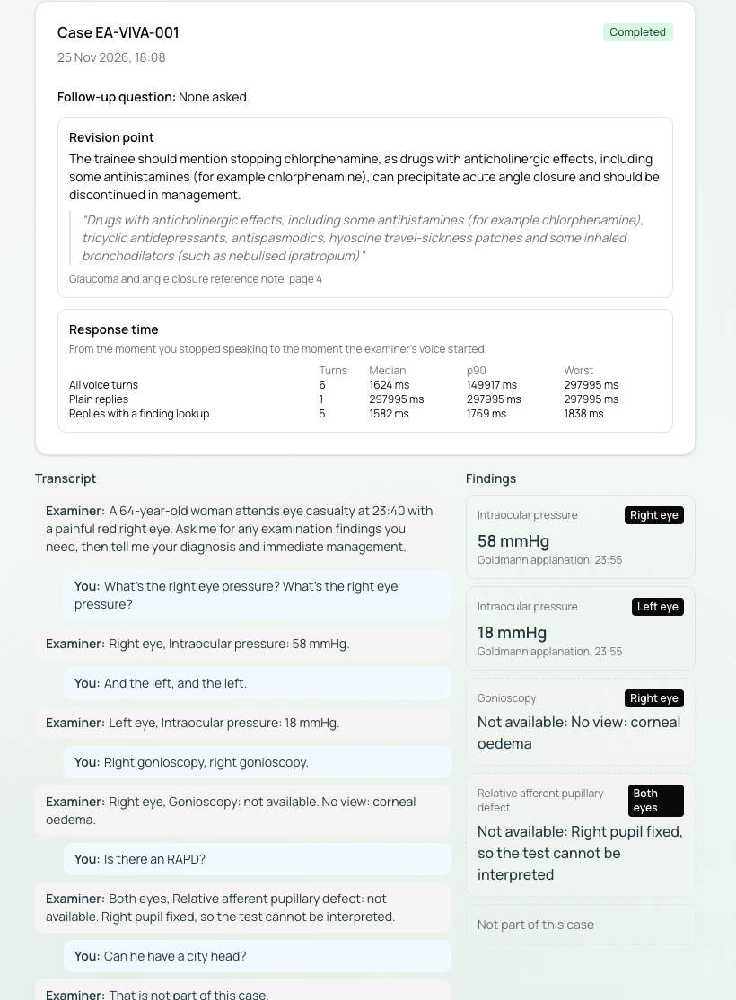
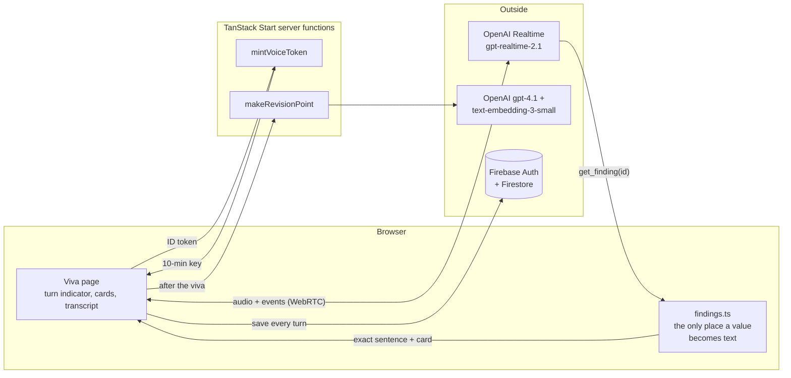

# Eye Academy voice viva

A short spoken ophthalmology viva. A signed-in trainee asks the examiner for findings on case
EA-VIVA-001, gives a diagnosis and management, answers one follow-up, and gets one revision point cited
to a page of the glaucoma reference note. Built with TanStack Start, Firebase Auth, Firestore and the
OpenAI Realtime API.



*A saved attempt reopened after the viva (development build, which also shows response times).*

## Status

| | |
|---|---|
| Build clock | 25 Nov 2026, 15:25 → 18:17 PKT (10:25 → 13:17 GMT): **2 h 52 min**. Tags [`four-hour-start`](../../tree/four-hour-start) and [`four-hour-mark`](../../tree/four-hour-mark) |
| At the four-hour mark | Everything in the brief works locally: voice viva, exact findings, unavailable findings, one follow-up, turn indicator, private saved attempts, cited revision point, three checks. See [`docs/status-four-hour-mark.md`](docs/status-four-hour-mark.md) |
| Where it stopped | After the latency and checks ticket. Not deployed; two last fixes passed unit tests but were not re-run by voice |
| After the clock | Response times hidden from trainees (still logged), favicon, this README and `CLAUDE.md`. Every later commit is after the `four-hour-mark` tag |

Setup before the clock (scaffold, dependencies, OpenAI docs check, PDF page map) is the first commit.
Each ticket is one commit; the plan is in [`docs/tickets.md`](docs/tickets.md).

## Run it locally

**You need:** Node 24+, pnpm 12, Java 11+ (only for the Firestore rules tests), a Firebase project
and an OpenAI API key with Realtime access.

1. **Firebase** (console.firebase.google.com):
   - Authentication → Email/Password → enable. Add two test users, for example `trainee-a@test.com` and `trainee-b@test.com`.
   - Firestore Database → create (production mode).
   - Project settings → Your apps → Web → copy the config.
2. **Config files** (both are git-ignored):
   ```bash
   cp .env.example .env.local        # Firebase web config (VITE_FIREBASE_*)
   echo "OPENAI_API_KEY=sk-..." > .dev.vars   # server-only secret, never sent to the browser
   ```
3. **Install, deploy the privacy rules, run:**
   ```bash
   pnpm install
   pnpm exec firebase login
   pnpm exec firebase deploy --only firestore:rules --project <your-project-id>
   pnpm dev
   ```
4. Open http://localhost:3100, sign in, press **Start viva** and allow the microphone. Use Chrome.

The reference note index (`data/note-index.json`) is committed. Rebuild it with `pnpm prep:note` if the
PDF changes.

| Command | What it does |
|---|---|
| `pnpm dev` | App on port 3100 |
| `pnpm test` | 28 unit tests |
| `pnpm test:rules` | 4 Firestore rules tests on the emulator |
| `pnpm check` | Typecheck + unit tests + rules tests |
| `pnpm check:findings` | Check 1 and 2: expected vs observed for each finding |
| `pnpm check:citation` | Check 3: runs the real revision point pipeline on three fixed answers |
| `pnpm prep:note` | PDF → page text, chunks and embeddings |

## How it works



**One finding turn.** The trainee says "right eye pressure". OpenAI's voice model calls the tool
`get_finding("iop_right")`. The browser answers with the formatter's result:

- the sentence to read out: "Right eye, Intraocular pressure: 58 mmHg."
- the data for the card: right eye, 58 mmHg, Goldmann applanation, 23:55.

The card is drawn from that result, never from the model's words. **The examiner instructions contain
no finding values** (a unit test checks all 24), so the model cannot mix up 58 and 18 from memory.

- **Unavailable findings:** decided by the `available` flag, never by `value`. So RAPD, which has a value but `available: false`, is "not available" with its reason. Anything not in the case is "not part of this case".
- **Units:** added only to bare numbers, so the pupil reads "5 mm", never "5 mm mm".
- **Turn-taking:** the indicator follows OpenAI's events, so the trainee always sees whose turn it is: Examiner speaking → Your turn → Listening → Thinking. Semantic voice detection waits for the trainee to finish a thought, and an optional **Done speaking** button ends a turn at once. A typed box works without a microphone.
- **Follow-up:** the examiner must ask permission through `ask_follow_up`. The app allows exactly one, and refuses `end_viva` until it has been asked.
- **Saved attempts:** stored at `users/{uid}/attempts/{id}`: transcript, findings, follow-up, response times and revision point. They are saved after every turn and reopen after a refresh. The rules let only the owner read or write (tested on the emulator). An attempt link contains the owner's id, so another user who opens it gets "Permission denied" from Firestore itself.
- **Secrets:** the OpenAI key stays on the server. The browser gets a 10-minute key only after the server verifies the Firebase ID token (with `jose`, which runs on Cloudflare Workers).

## Model choice

| | Chosen: OpenAI Realtime `gpt-realtime-2.1` | Alternative: Gemini Live |
|---|---|---|
| Connection | WebRTC: the browser handles mic, echo cancellation and playback | WebSocket: our own audio capture and playback code |
| Tool calls, turn detection | Function calling, semantic voice detection | Both supported |
| Key safety | Short-lived key from `/v1/realtime/client_secrets` | Ephemeral tokens (preview at the time) |
| Audio price per 1M tokens | $32 in / $64 out | Roughly 5× cheaper |

**Why OpenAI:**
- Reliable tool calls, which every finding depends on.
- The least audio code to write.
- Clear events for the turn indicator and the latency timer.
- It is already in Eye Academy's stack.

Gemini Live is the alternative I would test first, because of cost.

**Revision point:** `gpt-4.1` at temperature 0 (the same transcript gives the same point) and
`text-embedding-3-small`. I tried `gpt-4.1-mini` first. It judged a correct step ("lie her flat") as a
mistake, so I switched.

## Response time

The timer starts at `input_audio_buffer.speech_stopped`, when the server decides the trainee has
finished. It stops at `output_audio_buffer.started`, when the examiner's audio starts playing in the
browser. Both are measured with `performance.now()`. The wait for end of speech happens before the
timer starts, so it is not included.

| Turn | Turns | Median | p90 | Worst |
|---|---|---|---|---|
| Finding lookup (tool call, then reply) | 5 | 1582 ms | 1769 ms | 1838 ms |
| Plain reply | 2 | 990 ms | – | 1523 ms |

Every sample is saved with the attempt and logged for developers. Trainees do not see timings.

## Three checks

Full detail, including retrieved pages and the cited passages: [`docs/checks.md`](docs/checks.md).

| Check | Expected | Observed |
|---|---|---|
| Available finding: "right eye pressure", "and the left" | Right eye 58 mmHg (Goldmann, 23:55); left eye 18 mmHg | ✅ by voice and `pnpm check:findings` |
| Unavailable finding: right gonioscopy, RAPD, CT head | "Not available: No view: corneal oedema"; RAPD not available with its reason; CT head not part of this case | ✅ by voice (CT head heard as "city head", still correct) and script |
| Citation: an answer that misses the sulfonamide allergy check | Page 6, excerpt about sulfonamide | ✅ Retrieved pages 6, 9, 8, 3. Cited page 6: "Check for sulfonamide allergy, kidney disease, low potassium and sickle cell disease before giving it." |
| Citation: weak point the note does not cover | "No support found in the note" | ✅ |

## Handover: the reference note

**Preparation** (`pnpm prep:note`, [`scripts/prep-note.ts`](scripts/prep-note.ts)):

1. pdfjs extracts the text of each physical page.
2. The printed footer number must equal the page index, otherwise the script stops. A wrong page number would make every citation wrong.
3. Repeated headers and footers are removed.
4. Each page is split into chunks of a few sentences. **A chunk never crosses a page**, so it always has exactly one page to cite.
5. Each chunk is embedded, and everything is written to `data/note-index.json`: 10 pages, 45 chunks.

**Passage selection** (after the viva, [`src/server/revision-core.ts`](src/server/revision-core.ts)):

1. The model compares the trainee's words with the examiner's key points, picks the biggest gap and writes a search query. It is told to judge against the key points only, not outside knowledge.
2. Hybrid search keeps the top 4 chunks, scored half on keywords and half on meaning:
   - **BM25 (keywords)** catches exact drug names like "acetazolamide".
   - **Embeddings (meaning)** catch paraphrases.
3. The model writes one point and quotes one passage word for word.
4. **Code then checks the quote.** It must appear on the cited page, and that page must be one of the retrieved pages. The check tolerates line breaks, hyphen splits and capital letters, but not a paraphrase. If any check fails, the trainee sees "No support found in the note".

**Distractors:** "sulfonamide" appears on pages 4, 6, 8 and 9, but only page 6 is about checking for
allergy before acetazolamide. The acetazolamide sentence also crosses from page 5 to page 6. Page map:
[`docs/note-page-map.md`](docs/note-page-map.md).

## AI coding tools

I built this with Claude Code.

**Concrete example: the findings formatter**
([`src/case/findings.ts`](src/case/findings.ts)). Claude Code wrote it test-first, one test at a time.
The tests pin the traps in the case data:

- 58 vs 18 mmHg
- "5 mm" never doubled
- RAPD hidden even though it has a value
- an unknown finding is "not part of this case"
- all 24 findings format without errors

**How I verified it:**

- 9 unit tests.
- `pnpm check:findings`.
- A voice run where each spoken answer and card matched the expected text (see Three checks).

**Verification also caught AI mistakes:**

- The shadcn CLI installed an unrelated npm package called `cn`. It was spotted and removed.
- The citation check exposed `gpt-4.1-mini`'s wrong judgement.
- A debug log of voice events showed a bug where the app asked for a new reply while one was still in progress. That is now fixed with a queue.

## Improvements

**1. Built: the app enforces the one follow-up.** The brief requires one spoken follow-up, and in one
test run the model ended the viva without asking it. A prompt cannot guarantee that, but code can:

- The model must call `ask_follow_up`. The app allows exactly one.
- `end_viva` is refused until the follow-up has been asked.
- Both rules are unit-tested.

**2. Sketched: an end-to-end test on the Firebase emulators.** Today the full voice path is checked by a
person, because signing in uses a real account. The next step is a Playwright test against the Auth and
Firestore emulators, with fake users. It would sign in, use the typed input to ask for "right eye
pressure", check the card shows "58 mmHg" and "Right eye", finish the viva, reload the attempt, and
confirm a second user gets "Permission denied". I would do this next because it turns most of the manual
checks into one repeatable command. That makes it safe to change the prompt or the model. The server's
token check would need an emulator mode, allowed only in development.

## For the walkthrough

| Change | Where | How to check |
|---|---|---|
| A finding's value, unit or availability | `data/case-ea-viva-001.json` (validated with zod on load) | `pnpm check:findings`, `pnpm test`. The tests pin today's values, so they should fail on purpose |
| Number of follow-ups | `MAX_FOLLOW_UPS` in `src/voice/session-config.ts` | `pnpm test` (follow-up tests) |
| Examiner behaviour | `buildSessionConfig` in `src/voice/session-config.ts` | `pnpm test` (no finding values in instructions), then a voice run |
| Reference PDF | `data/glaucoma-note.pdf` | `pnpm prep:note` (stops on a page-number mismatch), then `pnpm check:citation` |
| Privacy rules | `firestore.rules` | `pnpm test:rules` |

A dev-only **Copy debug log** link on the viva page copies every voice event with timings, so you can
see where a session went wrong.

## Known limitations

- **Pauses:** a long pause mid-answer can still end the trainee's turn. Use **Done speaking**, or a slightly longer wait.
- **Transcription:** it can mishear medical terms ("CT head" became "city head"). The tool lookup still worked.
- **One case:** there is one case and one note. The code reads them from files, but there is no case picker.
- **Deployment:** not deployed yet. A Cloudflare Workers config is included (`pnpm deploy`); the OpenAI key goes in with `wrangler secret put OPENAI_API_KEY`.

## Project layout

```
src/case/        case schema (zod) and the findings formatter
src/voice/       Realtime session config, the voice hook, follow-up rules, latency maths
src/note/        chunking, hybrid search, excerpt check
src/server/      server functions: voice key, revision point, ID-token check
src/attempts/    Firestore save/load and recorder hooks
src/routes/      login, viva, attempts list, attempt page
scripts/         prep-note, check-findings, check-citation
tests/rules/     Firestore rules tests (emulator)
docs/            tickets, checks, page map, Realtime notes, status at four hours
```
