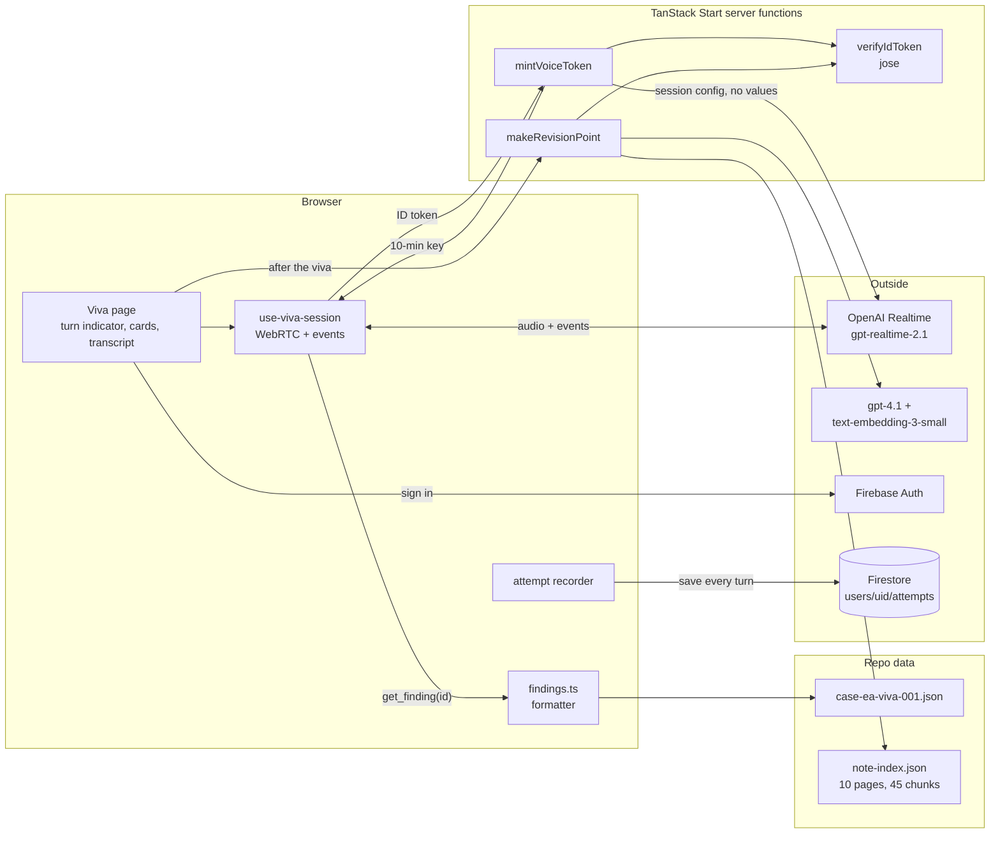
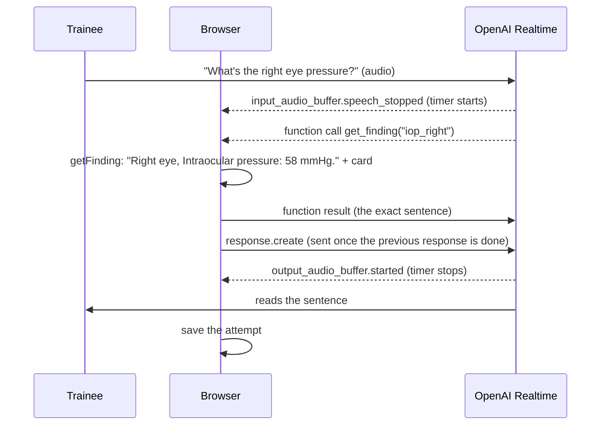

# Architecture

Three parts:
- **The browser** runs the viva: microphone, speaker, turn indicator, finding cards and transcript.
- **Our server** is a set of TanStack Start server functions. They hold the OpenAI key and check sign-in.
- **Outside services:** OpenAI for voice and text, and Firebase for sign-in and storage.

The case file and the reference note are read from `data/`.

## System

## One finding turn

1. The trainee speaks. OpenAI decides when they have finished a thought (semantic voice detection), and the latency timer starts.
2. The voice model calls `get_finding` with one id from a fixed list, or `not_in_case`.
3. The browser runs `getFinding` (`src/case/findings.ts`). This is the only place where a value, eye and unit become text, and the card is drawn from its result.
4. The browser sends the exact sentence back and asks for a reply. Requests are queued, because OpenAI allows only one response at a time.
5. The examiner reads the sentence aloud. The timer stops when its audio starts playing.

If a finding is unavailable, step 3 returns "not available" with the reason from the case. The
`available` flag decides this, never `value`.

## Follow-up and end

1. After the diagnosis and management, the model must call `ask_follow_up` before asking its question. The app allows exactly one.
2. After the answer, the model calls `end_viva`. The app refuses it until the follow-up has been asked.
3. The session ends once the examiner has finished speaking.

The rules are in `src/voice/follow-up.ts`.

## After the viva: revision point

1. **Gap:** `gpt-4.1` compares the trainee's words with the examiner's key points, and writes a search query for the biggest gap.
2. **Search:** hybrid search over page-bound chunks. Each chunk is scored half on keywords (BM25) and half on meaning (embeddings), and the top 4 are kept.
3. **Point:** `gpt-4.1` writes one point that quotes one passage word for word, and names its page.
4. **Check:** code accepts the point only if the quote is on the cited page and that page was retrieved. Otherwise the trainee sees "No support found in the note".
5. The point is shown on Viva complete and saved to the attempt.

The note is prepared once with `pnpm prep:note`. Each page is read, its printed page number is
checked, and the page is chunked and embedded.

## Data

Each attempt is one Firestore document at `users/{uid}/attempts/{attemptId}`:

| Field | Contents |
|---|---|
| `caseId`, `status` | `EA-VIVA-001`; `in_progress`, `completed` or `interrupted` |
| `turns` | `{ role, text, at }` for the examiner and the trainee |
| `revealed` | Each finding result exactly as shown on its card |
| `followUps` | The follow-up question that was asked |
| `latency` | `{ ms, kind, finding }` for each turn |
| `revision` | The cited point, or "No support found", plus the retrieved pages |
| `createdAt`, `updatedAt` | Server timestamps |

It is created when the viva starts and saved after every change, so a refresh loses at most the turn
in progress.

## Security

- The OpenAI key stays on the server (`.dev.vars` locally, `wrangler secret` in production). The browser gets a 10-minute key, and only after the server has verified its Firebase ID token with `jose`.
- `firestore.rules` lets only the owner read or write `users/{uid}/attempts/*`, and denies everything else. Four rules tests run on the emulator.
- The attempt link contains the owner's id. Another user who opens it gets "Permission denied" from Firestore itself.
